# Studes — Student Accommodation Platform

## Student Information
- **Name:** Ignatious Shingirirai Tsikira
- **Student Number:** [Insert Student Number]
- **Module:** WEDS5020 / WEDE5020 — Web Development
- **Submission:** Part 3 (final Portfolio of Evidence)

## Links
- **Live website (GitHub Pages):** https://shingi-tsikira.github.io/studes-website
- **GitHub repository:** https://github.com/EMGPSD/wede5020-2026-part-3-shingi-tsikira

## Project Overview
Studes is a hypothetical organisation (approved by the lecturer) whose website connects students searching for accommodation with landlords who have rooms and units to let near tertiary campuses in Johannesburg and Pretoria. The site was built in three parts: HTML structure (Part 1), CSS styling and responsive design (Part 2), and JavaScript functionality, SEO, external services and deployment (Part 3).

## Website Goals and Objectives
- Give students a searchable, filterable, visual way to compare accommodation near campus.
- Give landlords a direct channel to list properties and reach student tenants.
- Replace unverifiable channels (WhatsApp groups, noticeboards) with one trustworthy platform.
- Give users transparent costs *before* they commit (instant estimate, deposit and fees).
- **KPIs:** number of active listings, enquiries generated per listing, enquiry-to-move-in conversion.

## Timeline and Milestones
| Part | Focus | Status |
|------|-------|--------|
| Part 1 | Planning, research, HTML structure | Complete |
| Part 2 | CSS styling, responsive design | Complete |
| Part 3 | JavaScript, SEO, external services, deployment | Final submission |

---

## Part 3 — Features, Implementation and Evidence

### 1. Image gallery with lightbox (`gallery.html`, `js/gallery.js`)
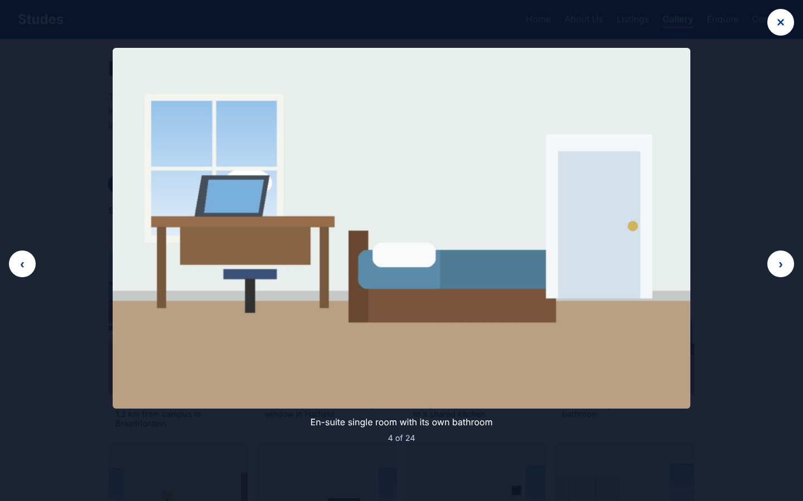

- **What it does:** 24 categorised images (single rooms, shared living, studios, campus & area, amenities). Category buttons and a keyword search filter the grid; selecting an image opens an accessible lightbox with previous/next buttons, captions, an "n of N" counter, keyboard (←, →, Esc), swipe on touch screens, a focus trap and focus returned to the thumbnail on close.
- **Business purpose:** students decide on accommodation visually; fast, filterable photos reduce uncertainty and increase enquiries.
- **Implementation:** thumbnails (480px) load in the grid and full images (1200px) load only in the lightbox, using `srcset`/`sizes` and `loading="lazy"` for performance. Filtering toggles the `hidden` attribute from `data-category` and `data-keywords`.

```js
function show(index) {
  const list = visibleItems();
  current = (index + list.length) % list.length; // wraps around at both ends
  const item = list[current];
  img.src = item.dataset.full;
  caption.textContent = item.dataset.caption;
  counter.textContent = (current + 1) + ' of ' + list.length;
}
```
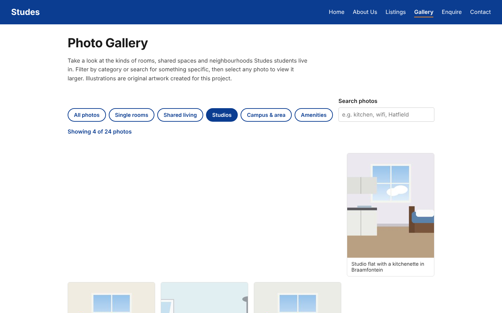

### 2. Listings search and filters (`services.html`, `js/script.js`)
- Live text search, room type and maximum price filters, a results counter (`aria-live`), a "no results" message and a reset button. Each card carries `data-type` and `data-price`.
- Each "Enquire" link pre-fills the enquiry form through the query string (`?type=student&room=single&area=braamfontein`).

### 3. Enquiry form, live estimate and response page (`enquiry.html`, `js/enquiry.js`, `response.html`, `js/response.js`)
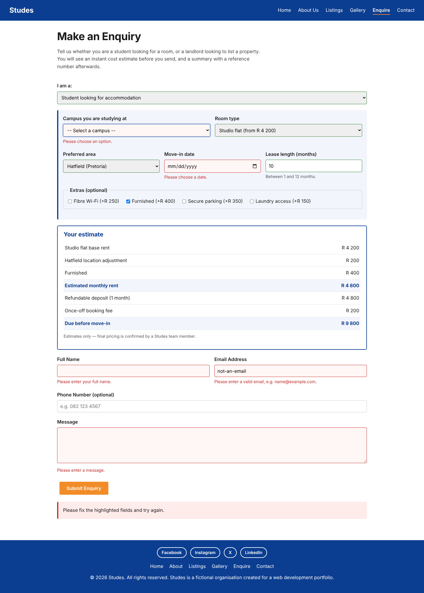

- **What it does:** the form shows different fields for students (campus, room type, area, move-in date, lease length, extras) and landlords (area, number of units, rent, listing plan). A live estimate updates as the user types: monthly rent, deposit (one month), once-off booking fee and the amount due before move-in; landlords see commission (5% standard / 8% featured) and payout. On a valid submit the data is saved to `sessionStorage` and the user is taken to `response.html`, which shows an invoice-style summary with a generated reference number (e.g. `STU-20261109-8LUC`) and a print button.
- **Business purpose:** transparent pricing builds trust, and a reference number gives both sides something to quote.
- **Security note:** the response page writes every value with `textContent`, never `innerHTML`, so typed input (e.g. `<script>`) is displayed as text and cannot run.

```js
function calculateEstimate(d) {            // pure function: easy to test
  const monthly = lines.reduce((sum, l) => sum + l.amount, 0);
  const deposit = monthly;                  // refundable: 1 month
  const upfront = monthly + deposit + BOOKING_FEE;
  ...
}
```
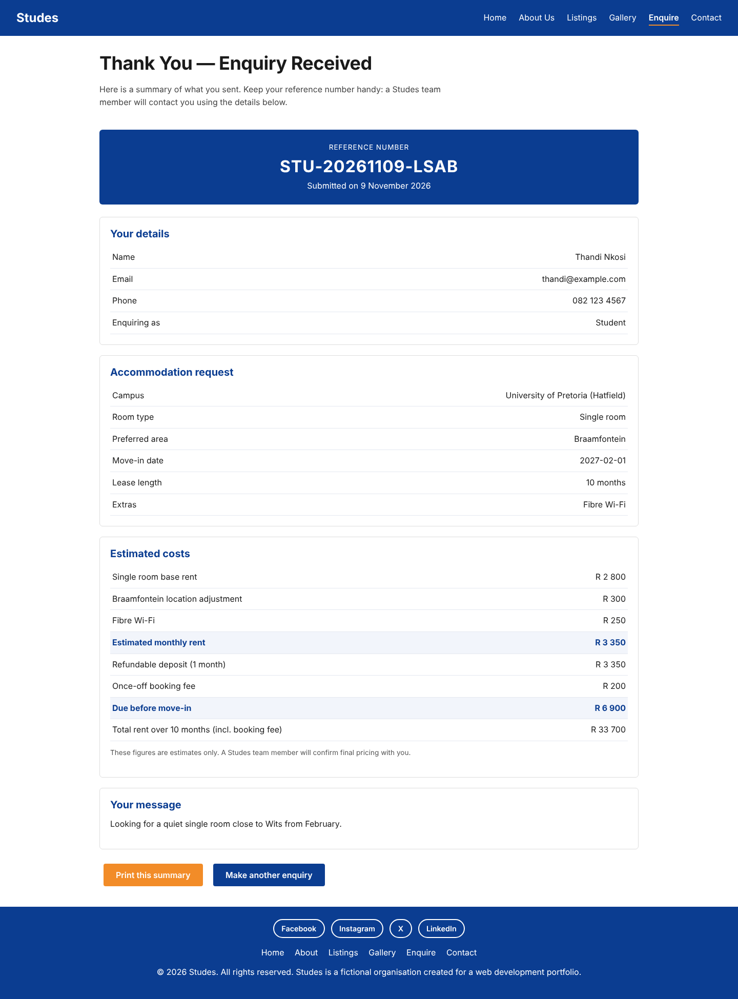

### 4. Form validation (`js/validation.js`)
- Rules are chosen per field with `data-validate` (name, email, South African phone, number with `data-min`/`data-max`, date not in the past and within 12 months, select, required, message length).
- Fields validate on blur, re-check live once invalid, the first invalid field is focused on submit, and errors are linked with `aria-describedby` and `aria-invalid`.

### 5. Contact form with `mailto:` (`contact.html`, `js/contact.js`)
- After validation the visitor's email app opens with the recipient, a subject (`[Studes] <topic> - <name>`) and a formatted body already filled in. A fallback "click here to send it" link is shown in case no email app opens. The content is URL-encoded with `encodeURIComponent`.

```js
return 'mailto:' + TO + '?subject=' + encodeURIComponent(subject) +
       '&body=' + encodeURIComponent(body);
```

### 6. Interactive map — external service (`js/map.js`)
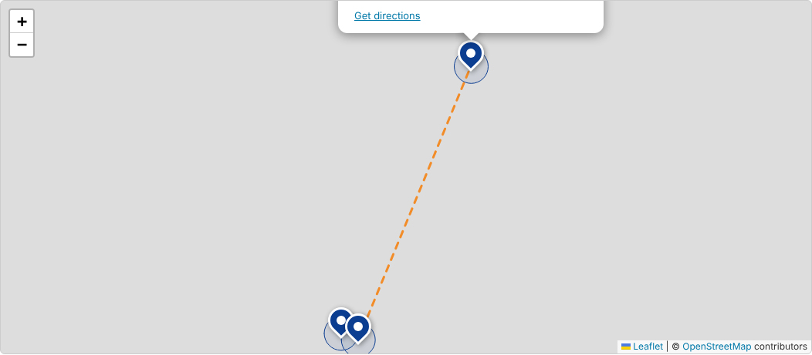

- Uses **Leaflet** (loaded from the unpkg CDN) with **OpenStreetMap** tiles. Three office markers with popups, 3 km service-area circles, a dashed line between the Johannesburg and Pretoria offices, the distance between them (haversine formula), "Show on map" buttons and Google Maps "Directions" links. If the library fails to load, a fallback message points to the directions links.
- *Note:* in my development environment map tiles could not be downloaded, so this screenshot shows markers on a blank background. [Replace with a live-site screenshot showing the street map.]

### 7. Other JavaScript
- Mobile navigation toggle (with `aria-expanded` and Escape to close), scroll-reveal animations using `IntersectionObserver` (disabled when the user prefers reduced motion), FAQ accordion using native `<details>`/`<summary>`, 404 page, social media links in the footer and on the contact page.

---

## Responsive Design Evidence
Breakpoints: desktop (above 1024px), tablet (`max-width: 1024px`), mobile (`max-width: 768px`). Layout uses Flexbox, `rem` units, `srcset` images and a hamburger menu on small screens.

| Page | Desktop (1440px) | Tablet (820px) | Mobile (390px) |
|---|---|---|---|
| Home | 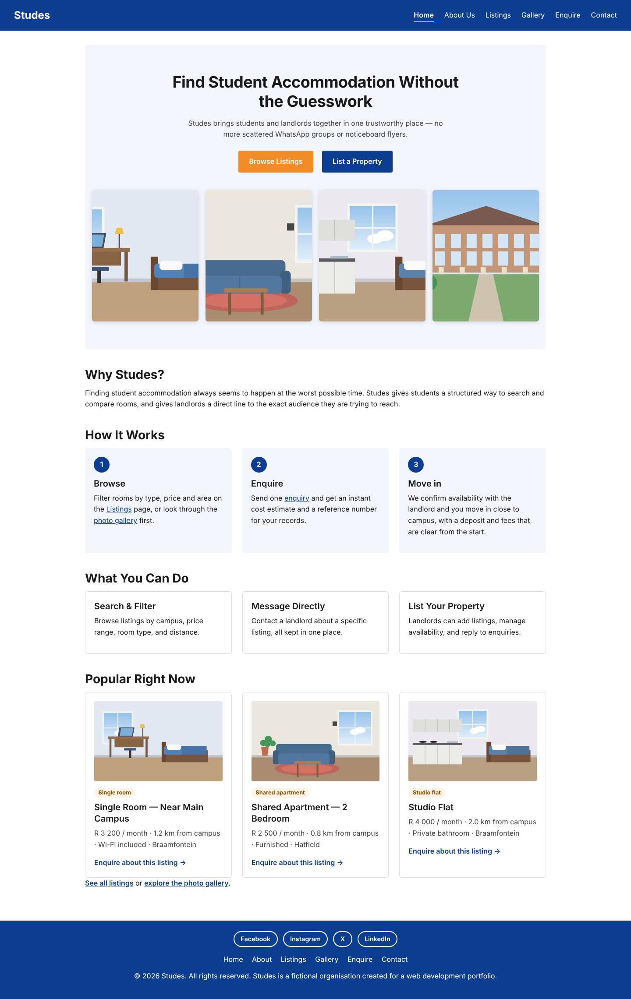 | 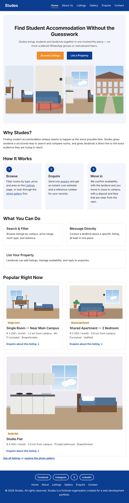 | 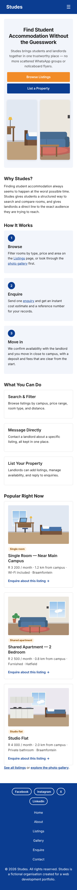 |
| Listings | 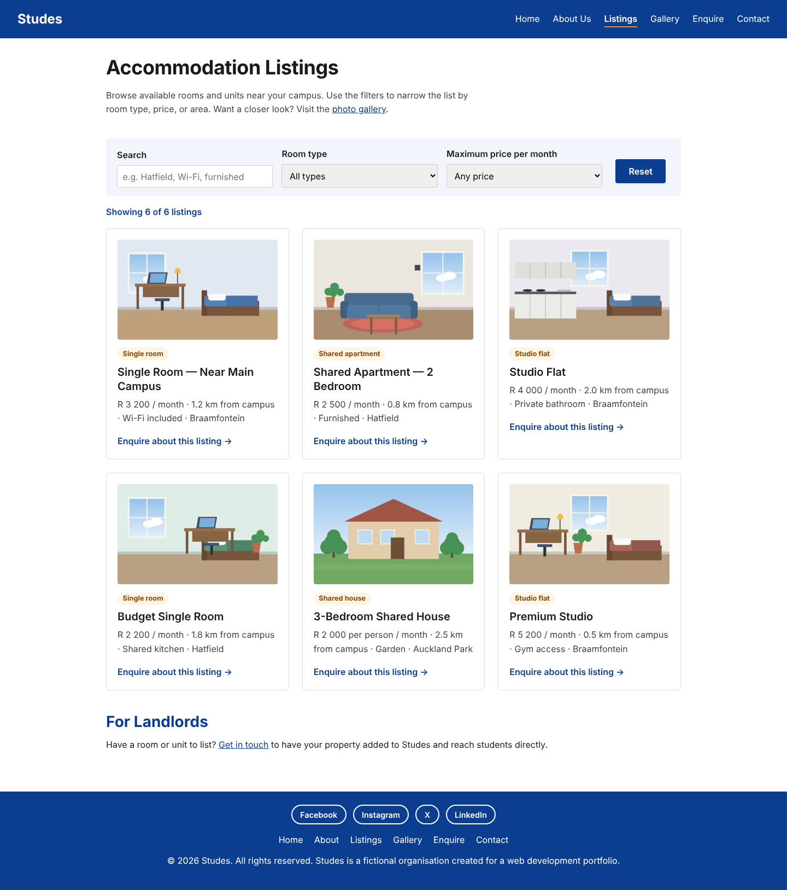 | 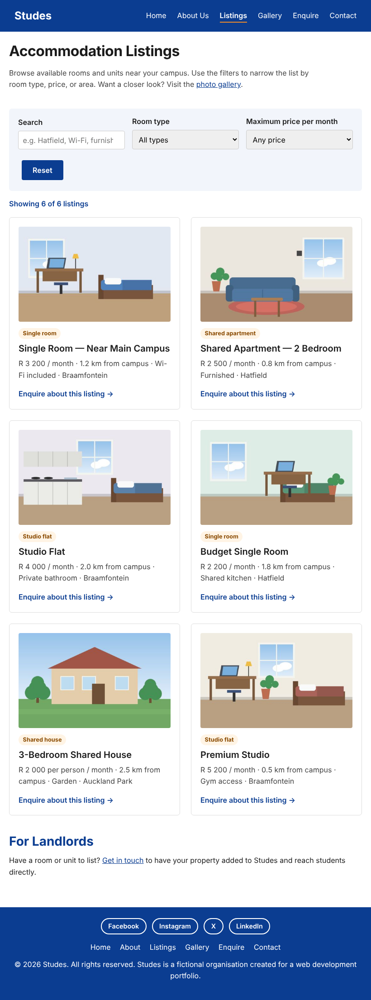 | 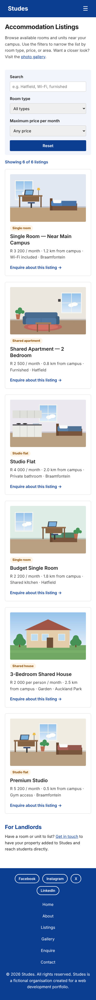 |
| Gallery | 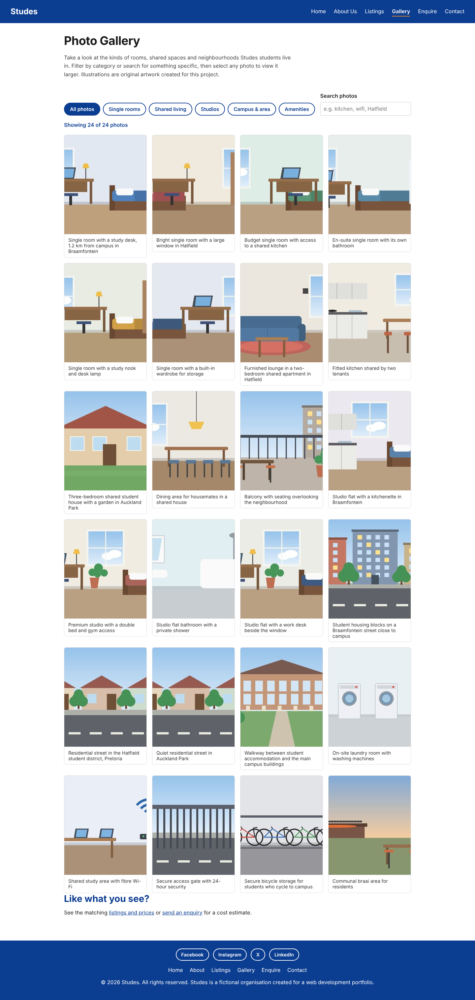 | 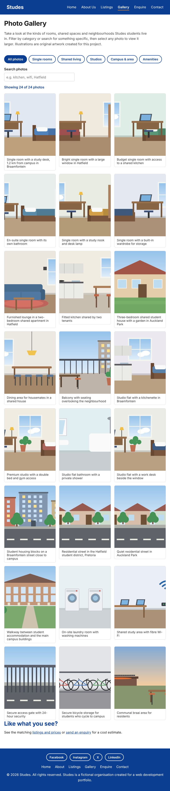 | 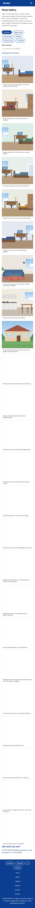 |
| Enquiry | 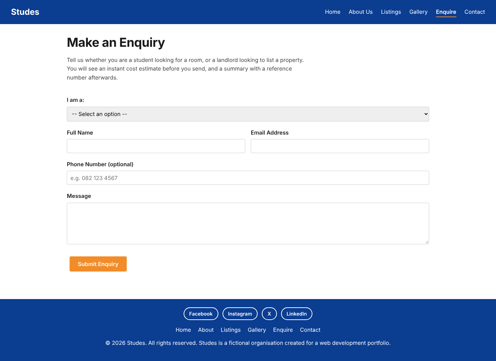 | 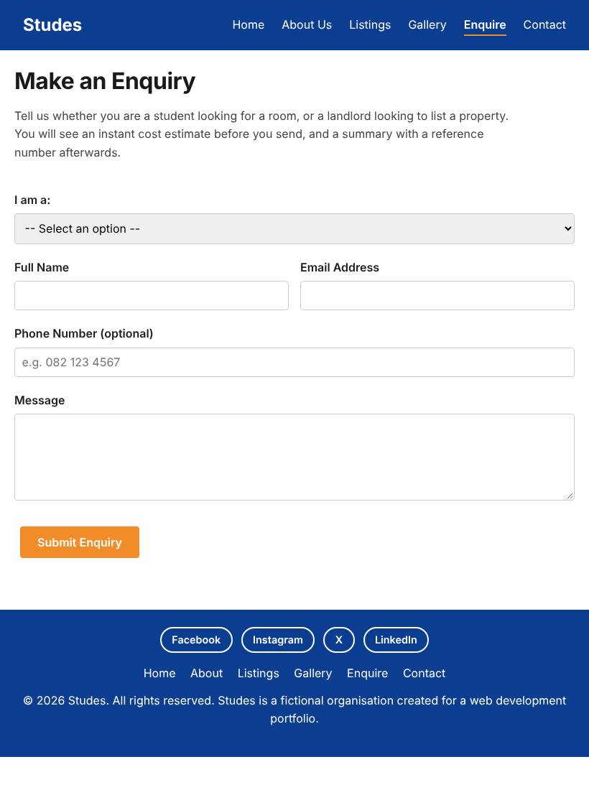 | 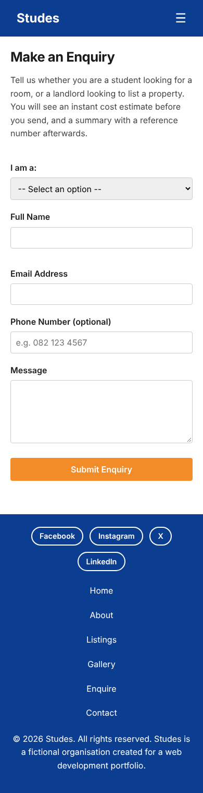 |
| Contact | 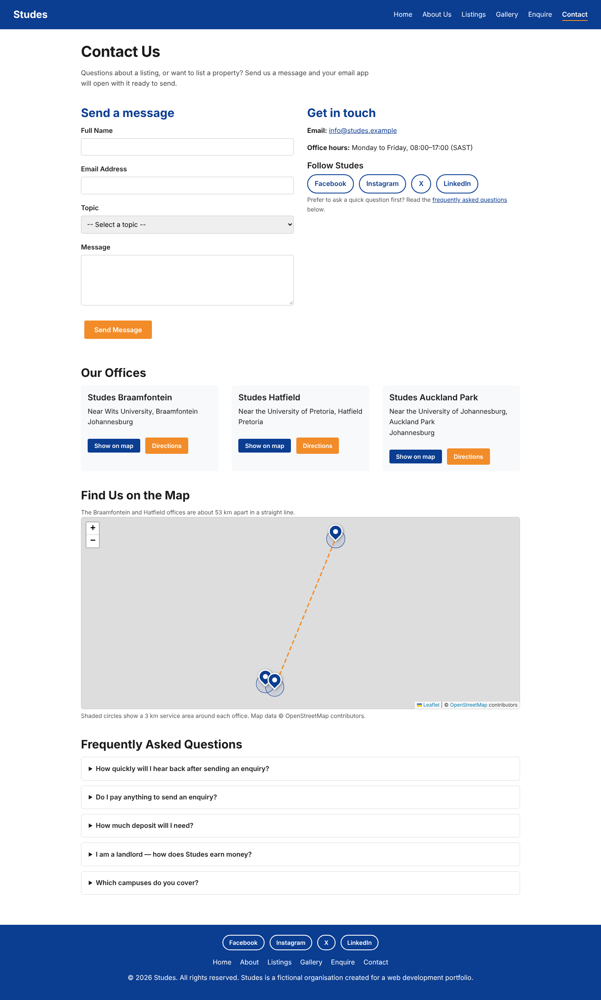 | 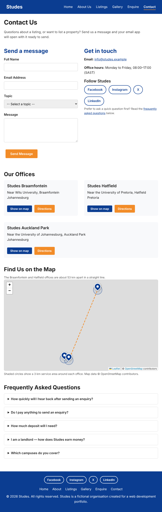 | 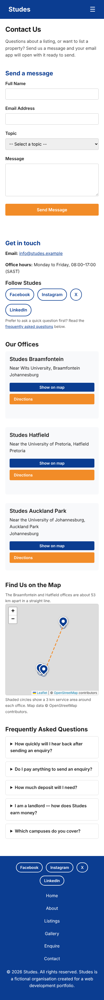 |

Mobile menu open: 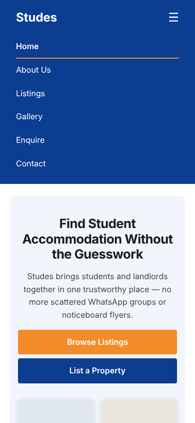 · Custom 404 page: 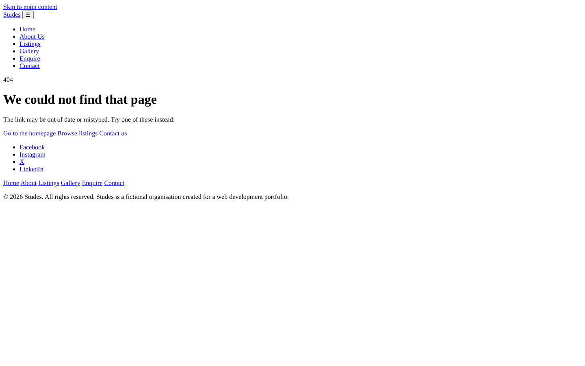

---

## SEO Evidence
- **Unique title and meta description on every page**, plus keywords, author, robots and canonical tags.
- **Open Graph and Twitter Card tags** including a 1200×630 share image (`images/studes-social-share.jpg`).
- **Structured data (JSON-LD):** `Organization` on the home page and `ContactPage` on the contact page.
- **`sitemap.xml` and `robots.txt`** in the root; the response page is `noindex` and disallowed because it is personal, per-visitor content.
- **Keyword strategy:** a shared core (student accommodation, student housing South Africa, rooms to rent near campus, Johannesburg, Pretoria, landlords) plus page-specific long-tail terms (e.g. "studio flat photos", "cost estimate").
- **Images:** meaningful file names (e.g. `studio-flat-kitchenette-braamfontein.jpg`) and descriptive `alt` text; `width`/`height` set to avoid layout shift; `srcset` for appropriate sizes.
- **Structure:** one `<h1>` per page, logical heading order, `lang="en-ZA"`, descriptive link text and internal links between pages.

```html
<title>Studes | Student Accommodation Near Campus in Johannesburg &amp; Pretoria</title>
<meta name="description" content="Find student accommodation near campus in Johannesburg and Pretoria...">
<link rel="canonical" href="https://shingi-tsikira.github.io/studes-website
<meta property="og:image" content="https://shingi-tsikira.github.io/studes-website/images/studes-social-share.jpg">
```

## Accessibility
Skip-to-content link, `aria-current` on the active page, visible focus outlines, labelled form fields, `aria-live` status messages, keyboard-operable lightbox with focus trap, `prefers-reduced-motion` support and print styles for the response page.

## Testing
Automated browser tests (Playwright) cover: listing filters, gallery filters and empty state, lightbox keyboard navigation and focus return, form validation errors, student and landlord cost estimates, the enquiry → response flow (including a check that typed HTML is not executed), `mailto:` encoding, the haversine distance, mobile navigation, and no horizontal scrolling on any page at 390px. A link/asset checker confirmed there are no broken internal links, every image has `alt` text and every page has exactly one `<h1>`.

---

## Deployment (GitHub Pages)
1. Push this folder to the GitHub repository.
2. In the repository: **Settings → Pages → Deploy from a branch → `main` / `(root)` → Save**.
3. Wait for the green "Your site is live" message, then open the live URL.
4. Replace the placeholder `https://shingi-tsikira.github.io/studes-website` with the real URL in all files (VS Code: Ctrl+Shift+H, "Replace All"). It appears in canonical tags, Open Graph tags, JSON-LD, `sitemap.xml`, `robots.txt`, `404.html` and this README.
5. Commit and push again, then test every page and form on the live site.

<!-- Add after deploying:  and a live-site screenshot -->

## File and Folder Structure
```
/
├── index.html
├── about.html
├── services.html          (Listings)
├── gallery.html
├── enquiry.html
├── response.html
├── contact.html
├── 404.html
├── sitemap.xml
├── robots.txt
├── README.md
├── css/
│   └── style.css
├── js/
│   ├── script.js          (nav, scroll reveal, listing filters, helpers)
│   ├── validation.js      (shared form validation)
│   ├── enquiry.js         (conditional fields, estimate, sessionStorage)
│   ├── response.js        (summary page)
│   ├── contact.js         (mailto)
│   ├── gallery.js         (filters + lightbox)
│   └── map.js             (Leaflet map)
├── images/
│   ├── favicon.png
│   ├── studes-social-share.jpg
│   └── gallery/           (24 full-size images + thumbs/ with 24 thumbnails)
└── screenshots/
```

## Improvements Since Part 2 and Lecturer Feedback
**Improvements made in Part 3:** added JavaScript interactivity, form validation, a gallery with lightbox, an enquiry-to-summary flow with cost estimates, a `mailto:` contact form, an interactive map, a 404 page, social links, an FAQ, expanded SEO, responsive images and automated testing.

**Lecturer feedback (Parts 1 and 2) and how it was addressed:** [Fill in from your marked feedback]

| Feedback received | Change made | Where |
|---|---|---|
| [e.g. feedback point 1] | [what you changed] | [file / section] |
| [e.g. feedback point 2] | [what you changed] | [file / section] |

## Changelog
- **v1.0 — Part 1:** [Insert date] Initial structure: five HTML pages, folder structure, README.
- **v2.0 — Part 2:** [Insert date] External stylesheet, typography scale, Flexbox layout, colour scheme, responsive breakpoints, hamburger menu.
- **v3.0 — 9 November 2026 (Part 3):**
  - Added gallery page with filters, search and accessible lightbox.
  - Added enquiry form conditional fields, validation, live cost estimate and `response.html` summary with reference number.
  - Added `mailto:` contact form, interactive Leaflet map, FAQ and social links.
  - Added 404 page, Open Graph/Twitter tags, JSON-LD, sitemap and robots.txt.
  - Replaced placeholder images with 24 original illustrations (meaningful file names, `srcset` thumbnails).
  - Added automated tests and deployed to GitHub Pages.

## AI Usage Disclosure
Claude (Anthropic, 2026) was used as an AI assistant during this project to help generate and debug HTML, CSS and JavaScript, to produce the original illustration images through code, to draft documentation (including this README) and to suggest SEO and accessibility improvements. I reviewed, tested and understand the submitted code and I take responsibility for the final work. [Student: confirm that this describes your use accurately.]

## Image Credits
All images in `images/` were generated for this project as original illustrations; no third-party photographs are used. Map tiles and the map library are credited below. Company details, addresses, prices and the `studes.example` email domain are fictional.

## References
- Agafonkin, V. (2023) *Leaflet: an open-source JavaScript library for mobile-friendly interactive maps* (v1.9.4). Available at: https://leafletjs.com (Accessed: 9 November 2026).
- Google (2026) *Google Maps URLs*. Available at: https://developers.google.com/maps/documentation/urls/get-started (Accessed: 9 November 2026).
- Google (2026) *Introduction to robots.txt*. Available at: https://developers.google.com/search/docs/crawling-indexing/robots/intro (Accessed: 9 November 2026).
- MDN Web Docs (2026) *Intersection Observer API*. Available at: https://developer.mozilla.org/en-US/docs/Web/API/Intersection_Observer_API (Accessed: 9 November 2026).
- MDN Web Docs (2026) *Window: sessionStorage property*. Available at: https://developer.mozilla.org/en-US/docs/Web/API/Window/sessionStorage (Accessed: 9 November 2026).
- Nielsen, J. (1994) *Usability Engineering*. San Francisco: Morgan Kaufmann.
- Norman, D.A. (2013) *The Design of Everyday Things: Revised and Expanded Edition*. New York: Basic Books.
- OpenStreetMap contributors (2026) *OpenStreetMap*. Available at: https://www.openstreetmap.org (Accessed: 9 November 2026).
- Schema.org (2026) *Organization*. Available at: https://schema.org/Organization (Accessed: 9 November 2026).
- Sitemaps.org (2026) *Sitemaps XML format*. Available at: https://www.sitemaps.org/protocol.html (Accessed: 9 November 2026).
- The Open Graph protocol (2026) *Open Graph protocol*. Available at: https://ogp.me/ (Accessed: 9 November 2026).
- W3C (2023) *Web Content Accessibility Guidelines (WCAG) 2.2*. Available at: https://www.w3.org/TR/WCAG22/ (Accessed: 9 November 2026).
- Anthropic (2026) *Claude* [Large language model]. Available at: https://claude.ai (Accessed: 9 November 2026).
